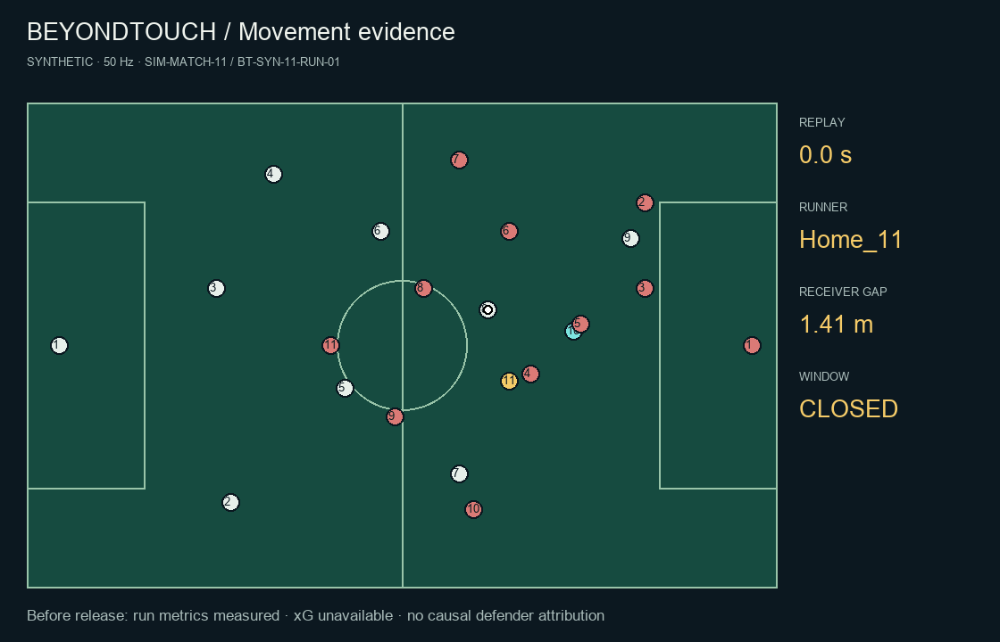

# 11 · Run ends beyond the offside line

**Synthetic simulation · 50 Hz tracking · no real match or real player names.**

[Download video (AVI)](video.avi) · [Interactive replay](replay.html) after downloading/extracting the repository

## Instance

Aster FC vs Boreal FC — synthetic match 11 · `SIM-MATCH-11` · `BT-SYN-11-RUN-01`

Simulated clock: 21:00.00–21:03.48 (simulated). Runner **Home_11**, carrier **Home_8**, candidate receiver **Home_10**. Shirt numbers are fictional identities. Source: authored trajectories in `src/Scripts/run_example_suite.py`. The analysis covers 0–3.48 s; the remaining replay is context.

## What happens

Offside positioning should not receive unrestricted attacking control credit.

## Calculated analysis

| Measure | Result | Meaning |
| --- | ---: | --- |
| Net attacking control-equivalent area | -204.00 m² | Single-runner endpoint model sensitivity |
| Area gained / lost | 0.00 / 204.00 m² | Both signs retained, net = gained − lost |
| Net penalty-area sensitivity | -13.84 m² | Boundary cells weighted by fractional overlap |
| Runner travel | 24.86 m | Sample-to-sample path length |
| Associated defender travel, combined | 12.93 m | Observed distance, not distance caused by the runner |
| Receiver gap, start → analysis end | 1.41 → 8.03 m | Nearest-defender distance |
| Longest candidate receiving window | 2.26 s | Threshold-defined opportunity |
| Total qualifying time | 2.26 s | Sum of qualifying sample intervals |
| Grid difference | 0.07 m² | Baseline 50 vs reference 75 columns |
| Declared grid-stability check | Pass | Numerical sensitivity, not match accuracy |

### Selected defenders

Up to two nearest outfield defenders within 10 m at the run start are retained for the whole window.

| Player | Travel m | High-speed travel m | Relative to defensive-unit translation m |
| --- | ---: | ---: | ---: |
| Away_4 | 12.93 | 0.00 | 11.38 |

## How to interpret it

The runner's position and velocity advance to the run end while other state stays frozen at the start. The resulting area is a model sensitivity, not causal credit. Defender distances are measured observations in this authored simulation. A receiving window needs onside position, ≥3 m receiver separation, ≥0.65 model control, and ≥1.5 m straight-lane clearance. xG and metabolic energy are unavailable. Values are rounded here; exact values and parameters are in metrics.json.

## Files and reproduction

`preview.gif` and `video.avi` are silent 5 fps previews. `replay.html` retains all 301 tracking frames. `metrics.json` contains the full analysis; `evidence.csv` contains 175 rows at 0.02 s intervals; `tracking-home.csv.gz` and `tracking-away.csv.gz` contain the source positions and velocities; `instance.json` records identities and provenance. Gzip compression is lossless.

From the repository root: `bash run.sh --case 11` on macOS/Linux, or `run.bat --case 11` on Windows. See [run instructions](../../guide/RUN_LOCALLY.md) and [metric definitions](../../guide/DEVELOPER_GUIDE.md).
