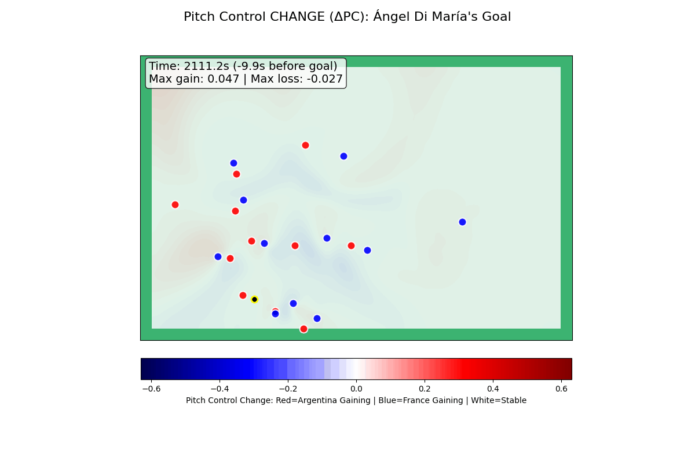

# WC 01 · Ángel Di María’s World Cup final goal

**Argentina v France · 18 December 2022 · goal 36′ · real-match rendered evidence supplied by Basel**

[Watch the evidence explainer MP4](../../uploads/BeyondTouch-DiMaria.mp4) · [Open the case](replay.html) after extracting the repository · [Official FIFA match context](https://www.fifa.com/en/tournaments/mens/worldcup/articles/argentina-france-2022-final-greatest-games)

## What is available

Complete supplied pitch-control animations, the sequence 94 influence video, and three annotated checkpoints are included. The plot legend identifies red as Argentina gaining control and blue as France gaining control. The numeric values below are **transcribed source annotations**, not fresh calculations from tracking.

| Source plot time s | Relative source goal time s | Displayed max gain | Displayed max loss |
| ---: | ---: | ---: | ---: |
| 2111.2 | -9.9 | +0.047 | -0.027 |
| 2117.2 | -3.9 | +0.314 | -0.185 |
| 2123.1 | +2.0 | +0.209 | -0.145 |

## What the values mean

Each maximum describes an extreme displayed value somewhere in the plotted ΔPC field. It is not a pitch-wide sum, m², xG or exclusive Di María attribution. The source’s exact ΔPC baseline/time differencing and player-dot identity mapping were not supplied. Therefore we do not infer causal run credit, integrate pixels into area, calculate defender kilometres, or invent receiving-window durations. The post-goal keyframe is context only. The plot clock is not independently aligned to the official broadcast clock.

The evidence explainer uses the full supplied rendered animation and attributed event analysis; it is not reconstructed raw tracking. Raw positions, velocities, grid values and per-player numerical attribution are unavailable for this case. The supplied media’s playback frame rate does not establish the tracking sample rate.

## Sources and audit

Case identity was provided by the user following a meeting with Bassel Hammad and corroborated with FIFA’s goal listing. Goal scorer: Ángel Di María, Argentina #11. We do not assign identities to unlabelled dots. `evidence.json` stores every transcribed value, source frame index, limitations and SHA-256 of each retained keyframe. `keyframe-1.png` to `keyframe-3.png` preserve the supplied scientific plots.

## Independently sourced event analysis

StatsBomb shot context is **0.30340916 xG**. The recorded attack contains **5 completed passes**, with **9.757 seconds** between the first recorded pass and the shot. Chain: Nahuel Molina → Alexis Mac Allister → Lionel Messi → Julián Álvarez → Alexis Mac Allister → Ángel Di María. Shot xG is not causal credit for a run. The event clock is not synchronized with the supplied plot.

Source: [StatsBomb open data](https://github.com/hudl/open-data), match 3869685. Only attributed derived analysis is included; original event records are not redistributed. See event-analysis.json and the [provider terms](../../guide/STATSBOMB_LICENSE.pdf).

## Complete supplied media

[ΔPC animation](sources/pitch-control-change.gif) · [Control animation](sources/pitch-control.gif) · [Sequence 94 ranking video](sources/influence-sequence-94.mp4). Source checksums are in source-media-manifest.json. The other supplied videos show sequences 88 and 262; they are kept separately under supplied-context and are not labelled as this goal.
