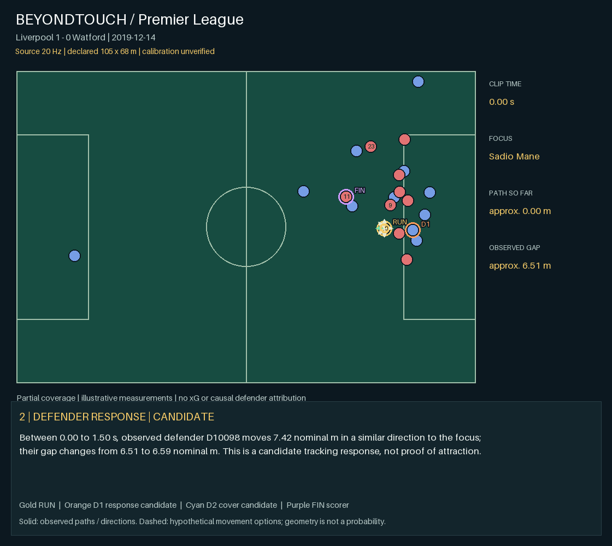

# PL-05 · Liverpool 1 - 0 Watford

**Real Premier League event · educational hand-collected trajectories · 20 Hz source**

[Video](video.avi) · [Interactive replay](replay.html) after extracting the repository

2019-12-14 · goal context: Mohamed Salah, 38′. [Official match context](https://www.premierleague.com/en/news/1524772/match-summary). Source play label: `Liverpool [1] - 0 Watford`. Focus: **Sadio Mané #10**, local source ID **13**. Mané is the focus in the counterattack leading to Salah’s first goal.

| Observed measure | Result |
| --- | ---: |
| Source clip duration | 11.20 s |
| Focus path length | ≈ 70.17 nominal m |
| Focus displacement | ≈ 62.49 nominal m |
| Start → end nearest observed defender gap | ≈ 6.51 → 5.74 nominal m |
| Associated observed defenders’ combined path | ≈ 153.99 m |
| Time with observed gap ≥ 3 nominal m | 10.80 s |
| Observed attackers / defenders | 10 / 11 |
| Full pitch control / receiving window / xG | unavailable |

## Interpretation

These are source-window measurements, not a certified off-ball-only interval. Some focus players carry or pass the ball during the clip. Distances scale the source’s normalized coordinates onto an **assumed 105 × 68 m pitch**; actual calibration is unverified. Missing players can make nearest-observed-defender gaps too large. Associated travel is not distance caused by the focus player. The ≥3 m time is a separation-only diagnostic, **not** the full candidate receiving window from the synthetic model.

The native samples remain 20 Hz. The browser interpolates positions for a 50 Hz display; the exported animation/video is 5 fps. Interpolation does not add observations or measurement accuracy. The underlying [Last Row source](https://github.com/Friends-of-Tracking-Data-FoTD/Last-Row) explicitly warns that these trajectories lack research accuracy. Credit: Ricardo Tavares / Last Row / Friends of Tracking. No broadcast footage is redistributed.

## Evidence and reproduction

`tracking.csv.gz` is the credited source subset; `metrics.json` contains exact results and assumptions; `evidence.csv` contains native timestamped measurements; `instance.json` records source and match context; `data.js` is the replay payload. Opponents without a confirmed shirt/name remain local IDs in the replay roster. The source frame clock is not a verified broadcast clock.

From the repository root: `bash run.sh --case 5` or `run.bat --case 5`. This recalculates the real-data measurements. Synthetic pitch-control tests remain available separately.

## Moving-scene model contrast

Conditional endpoint sensitivity: **+224.77 nominal m²** over the whole pitch. All other observed players and the ball use their actual endpoint states; only the focus player is held at its initial position and velocity in the reference. This does not freeze unrelated players. It remains a partial-coverage model diagnostic, not causal or complete-match attribution. Offside/GK identities are unconfirmed. See model-analysis.json.
