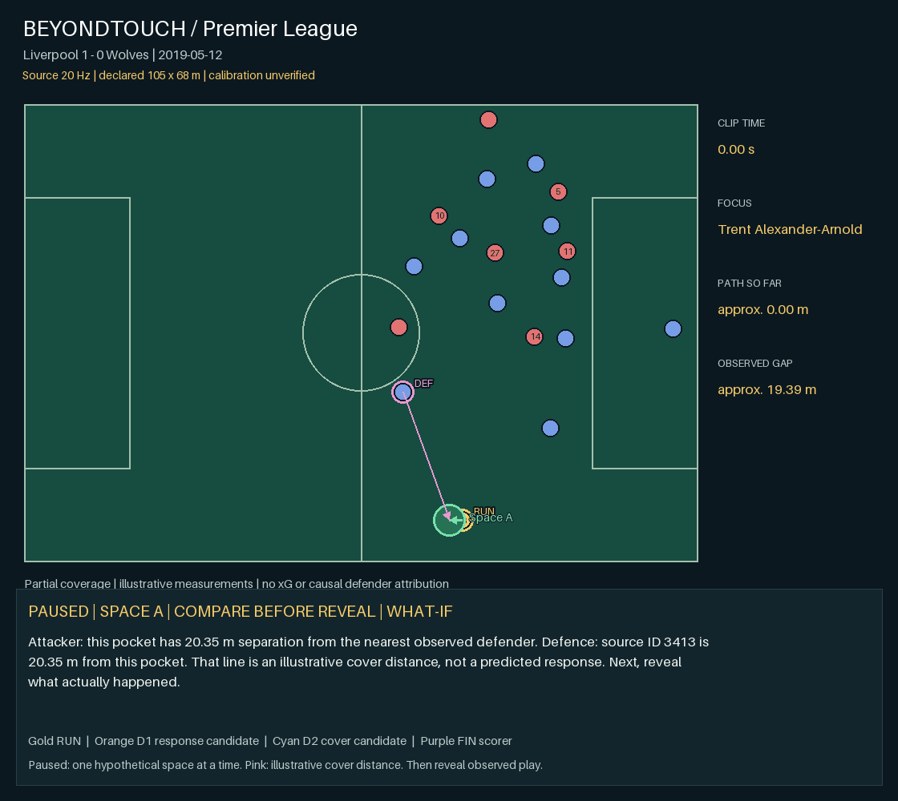

# PL-06 · Liverpool 1 - 0 Wolves

**Real Premier League event · educational hand-collected trajectories · 20 Hz source**

[Video](video.avi) · [Interactive replay](replay.html) after extracting the repository

2019-05-12 · goal context: Sadio Mané, 17′. [Official match context](https://www.wolves.co.uk/news/mens-first-team/20190512-liverpool-2-0-wolves-match-report/). Source play label: `Liverpool [1] - 0 Wolves`. Focus: **Trent Alexander-Arnold #66**, local source ID **12**. Alexander-Arnold is the focus in the sequence ending in Mané’s opening goal.

| Observed measure | Result |
| --- | ---: |
| Source clip duration | 7.80 s |
| Focus path length | ≈ 37.79 nominal m |
| Focus displacement | ≈ 35.80 nominal m |
| Start → end nearest observed defender gap | ≈ 19.39 → 5.86 nominal m |
| Associated observed defenders’ combined path | not selected |
| Time with observed gap ≥ 3 nominal m | 6.65 s |
| Observed attackers / defenders | 8 / 11 |
| Full pitch control / receiving window / xG | unavailable |

## Interpretation

These are source-window measurements, not a certified off-ball-only interval. Some focus players carry or pass the ball during the clip. Distances scale the source’s normalized coordinates onto an **assumed 105 × 68 m pitch**; actual calibration is unverified. Missing players can make nearest-observed-defender gaps too large. Associated travel is not distance caused by the focus player. The ≥3 m time is a separation-only diagnostic, **not** the full candidate receiving window from the synthetic model.

The native samples remain 20 Hz. The browser interpolates positions for a 50 Hz display; the exported animation/video is 5 fps. Interpolation does not add observations or measurement accuracy. The underlying [Last Row source](https://github.com/Friends-of-Tracking-Data-FoTD/Last-Row) explicitly warns that these trajectories lack research accuracy. Credit: Ricardo Tavares / Last Row / Friends of Tracking. No broadcast footage is redistributed.

## Evidence and reproduction

`tracking.csv.gz` is the credited source subset; `metrics.json` contains exact results and assumptions; `evidence.csv` contains native timestamped measurements; `instance.json` records source and match context; `data.js` is the replay payload. Opponents without a confirmed shirt/name remain local IDs in the replay roster. The source frame clock is not a verified broadcast clock.

From the repository root: `bash run.sh --case 6` or `run.bat --case 6`. This recalculates the real-data measurements. Synthetic pitch-control tests remain available separately.

## Moving-scene model contrast

Conditional endpoint sensitivity: **-97.48 nominal m²** over the whole pitch. All other observed players and the ball use their actual endpoint states; only the focus player is held at its initial position and velocity in the reference. This does not freeze unrelated players. It remains a partial-coverage model diagnostic, not causal or complete-match attribution. Offside/GK identities are unconfirmed. See model-analysis.json.

## Tactical story: run, response, cover, finish

Watch Trent Alexander-Arnold first, then the highlighted defender movements. A nearby defender moves with the run and a second defender later approaches the first defender’s earlier position. The goal is by Sadio Mané; the full space-creation link remains unconfirmed. Present this as a limited case, not a proven chain.

**1 · The attacking movement [observed]** — Trent Alexander-Arnold covers approximately 37.79 nominal metres across this clip. The source does not label an off-ball-only interval.

**2 · Defender response [candidate]** — Between 2.25–3.75 s, observed defender D6670 moves 2.86 nominal m in a similar direction to the focus; their gap changes from 3.19 to 3.88 nominal m. This is a candidate tracking response, not proof of attraction.

**3 · The covering movement [candidate]** — After that response, observed defender D3413 moves 2.71 nominal m closer to the first defender’s earlier location (3.75–5.25 s). This is a geometric covering candidate; no marking responsibility is supplied.

**4 · Space and the finisher [not_established]** — At the covering defender’s earlier location, nearest-observed-defender clearance changes from 0.00 to 3.47 nominal m. The complete link from this location to the finisher is not supported by the declared rule.

**5 · Goal context [context]** — The match context identifies Sadio Mané as the scorer at 17′. The source clip has no synchronized shot marker, so this does not validate the preceding causal chain.

See story.json for thresholds, selected source IDs and exact timestamps. Arrows and trails show observed motion; tactical responsibilities remain unconfirmed.
