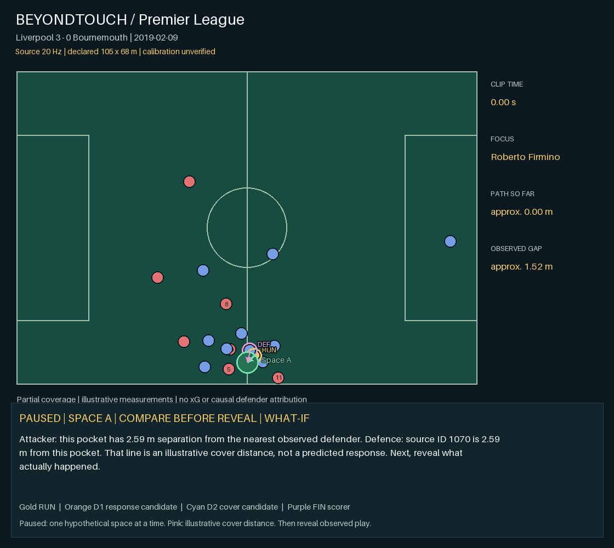

# PL-10 · Liverpool 3 - 0 Bournemouth

**Real Premier League event · educational hand-collected trajectories · 20 Hz source**

[Video](video.avi) · [Interactive replay](replay.html) after extracting the repository

2019-02-09 · goal context: Mohamed Salah, 48′. [Official match context](https://www.premierleague.com/en/news/1048354). Source play label: `Liverpool [3] - 0 Bournemouth`. Focus: **Roberto Firmino #9**, local source ID **14**. Firmino is the focus in the move ending in Salah’s goal.

| Observed measure | Result |
| --- | ---: |
| Source clip duration | 7.70 s |
| Focus path length | ≈ 51.54 nominal m |
| Focus displacement | ≈ 48.11 nominal m |
| Start → end nearest observed defender gap | ≈ 1.52 → 8.38 nominal m |
| Associated observed defenders’ combined path | ≈ 81.58 m |
| Time with observed gap ≥ 3 nominal m | 1.95 s |
| Observed attackers / defenders | 8 / 10 |
| Full pitch control / receiving window / xG | unavailable |

## Interpretation

These are source-window measurements, not a certified off-ball-only interval. Some focus players carry or pass the ball during the clip. Distances scale the source’s normalized coordinates onto an **assumed 105 × 68 m pitch**; actual calibration is unverified. Missing players can make nearest-observed-defender gaps too large. Associated travel is not distance caused by the focus player. The ≥3 m time is a separation-only diagnostic, **not** the full candidate receiving window from the synthetic model.

The native samples remain 20 Hz. The browser interpolates positions for a 50 Hz display; the exported animation/video is 5 fps. Interpolation does not add observations or measurement accuracy. The underlying [Last Row source](https://github.com/Friends-of-Tracking-Data-FoTD/Last-Row) explicitly warns that these trajectories lack research accuracy. Credit: Ricardo Tavares / Last Row / Friends of Tracking. No broadcast footage is redistributed.

## Evidence and reproduction

`tracking.csv.gz` is the credited source subset; `metrics.json` contains exact results and assumptions; `evidence.csv` contains native timestamped measurements; `instance.json` records source and match context; `data.js` is the replay payload. Opponents without a confirmed shirt/name remain local IDs in the replay roster. The source frame clock is not a verified broadcast clock.

From the repository root: `bash run.sh --case 10` or `run.bat --case 10`. This recalculates the real-data measurements. Synthetic pitch-control tests remain available separately.

## Moving-scene model contrast

Conditional endpoint sensitivity: **-18.84 nominal m²** over the whole pitch. All other observed players and the ball use their actual endpoint states; only the focus player is held at its initial position and velocity in the reference. This does not freeze unrelated players. It remains a partial-coverage model diagnostic, not causal or complete-match attribution. Offside/GK identities are unconfirmed. See model-analysis.json.

## Tactical story: run, response, cover, finish

Watch Roberto Firmino first, then the highlighted defender movements. A nearby defender moves in a similar direction, but a subsequent cover is not detected. The goal is by Mohamed Salah; the full space-creation link remains unconfirmed. Present this as a limited case, not a proven chain.

**1 · The attacking movement [observed]** — Roberto Firmino covers approximately 51.54 nominal metres across this clip. The source does not label an off-ball-only interval.

**2 · Defender response [candidate]** — Between 0.00–1.50 s, observed defender D1070 moves 4.57 nominal m in a similar direction to the focus; their gap changes from 1.52 to 4.79 nominal m. This is a candidate tracking response, not proof of attraction.

**3 · The covering movement [not_detected]** — No later defender meets the covering rule. A second covering defender must not be invented.

**4 · Space and the finisher [not_established]** — The full run → response → cover → finisher chain is not established for this source clip.

**5 · Goal context [context]** — The match context identifies Mohamed Salah as the scorer at 48′. The source clip has no synchronized shot marker, so this does not validate the preceding causal chain.

See story.json for thresholds, selected source IDs and exact timestamps. Arrows and trails show observed motion; tactical responsibilities remain unconfirmed.

[Annotated story MP4](story.mp4) · [AVI fallback](video.avi)
